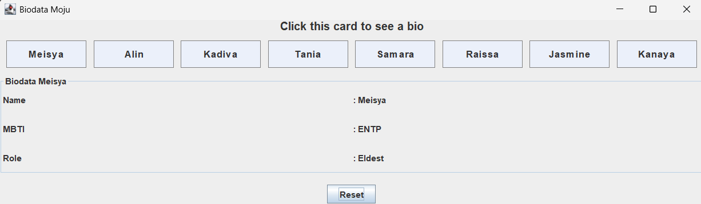
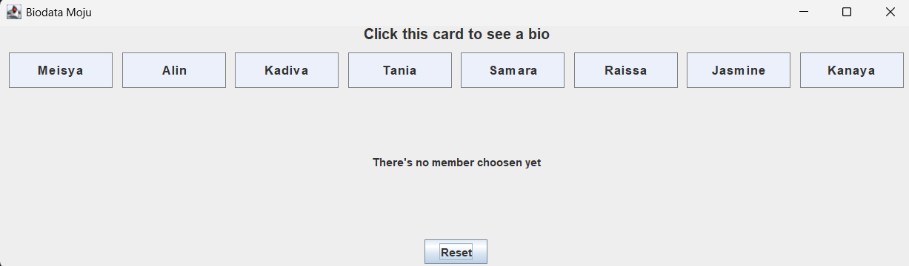

# Member Biodata Card (Java Swing GUI)

**NIM:** F1D02410072
**Name:** Meisya <full name>

## Description

A simple Java Swing application that shows team members as clickable cards. When a card is clicked, the member's biodata (name, MBTI, and role) is displayed in the panel below. A Reset button returns the view to its initial state.

## Screenshot




## Features

- Clickable member cards with a hover effect
- Biodata panel that switches depending on the selected card (CardLayout)
- Reset button to return to the initial view

## GUI Concepts Applied

| Concept | Implementation |
|---|---|
| Top-level container | `JFrame` (`FrameMember`) |
| Atomic components | `JLabel`, `JButton` |
| Intermediate containers | `JPanel` (card, detail, bottom, and center panels) |
| Layout managers | `BorderLayout`, `GridLayout`, `CardLayout`, `FlowLayout` |
| Event handling | `MouseAdapter` (click, hover) and `ActionListener` (Reset button) |

## Class Structure

| Class | Responsibility |
|---|---|
| `Main` | Entry point, starts the GUI on the Event Dispatch Thread |
| `FrameMember` | Main `JFrame`, assembles all panels and layouts |
| `KartuMember` | Clickable member card (`JPanel`) with a `PilihListener` interface |
| `PanelDetail` | Panel that displays one member's biodata |
| `Member` | Data model (name, MBTI, role) |

## How to Run

```bash
javac *.java
java Main
```

If the files are inside a package, run from the `src` folder instead:

```bash
javac <package-name>/*.java
java <package-name>.Main
```

## Author

Meisya, Informatics Engineering, Universitas Mataram