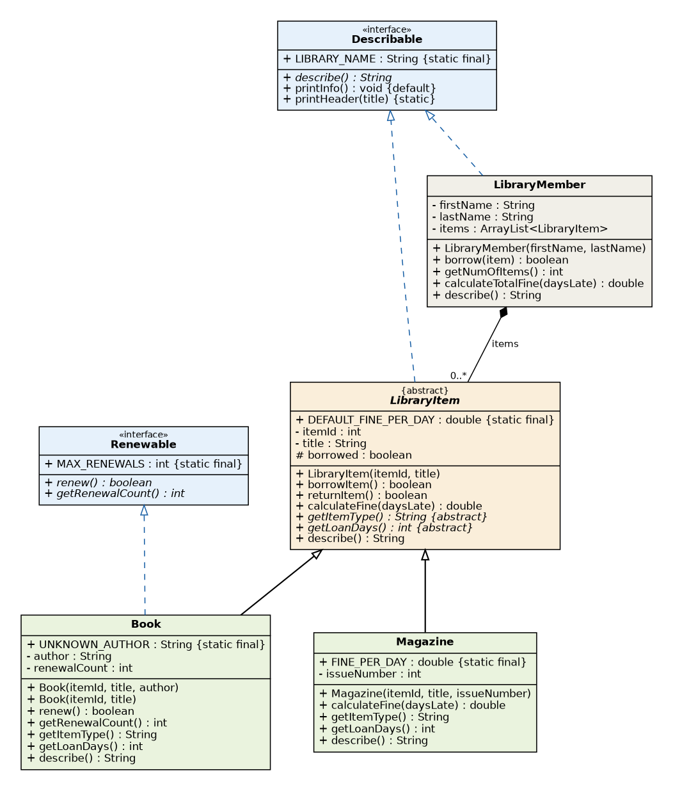

# Case Study: Mini Library System
### Abstract Class, Interface, Inheritance & Polymorphism in Java

**Course:** PBO (Object-Oriented Programming)
**Name / NIM / Class:** `<Meisya Ananda Puteri>`, `<F1D02410072>`, `<A>`

---

## 1. Background

A library lends **items** to **members**. Not every item is the same: a **book** has a long loan period and can
be renewed, while a **magazine** has a short loan period, cannot be renewed and has a higher late fine.
This case study models that difference with an **abstract class**, **interfaces**, **inheritance** and
**polymorphism**, and nothing else beyond what the slides cover.

## 2. Problem

1. Books and magazines share some behaviour (borrow, return) but differ in others (loan period, fine rule).
   How do we model that without copying code?
2. How can one line of code treat every item the same way while each one does the right thing?
3. `LibraryMember` and `LibraryItem` are **not** related by inheritance, yet both must describe themselves. How?
4. Only *some* items can be renewed. How do we express that?

## 3. Design



| Class / interface | Kind | Role |
|---|---|---|
| `LibraryItem` | abstract class | Shared state (`itemId`, `title`, `borrowed`) and methods (`borrowItem`, `returnItem`, `calculateFine`). Forces children to write `getItemType()` and `getLoanDays()`. |
| `Book` | concrete class | 14-day loan, default fine. Implements `Renewable`. |
| `Magazine` | concrete class | 3-day loan, **overrides** `calculateFine()` (higher fine). Not renewable. |
| `Describable` | interface | "Can describe itself": `LibraryItem` and `LibraryMember`. |
| `Renewable` | interface | "Can be renewed": only `Book`. |
| `LibraryMember` | class | **Has** many items (composition). |
| `MiniLibraryDemo` | class | `main()` with expected values. |

**Why an abstract class for `LibraryItem`?** The item types share state and code, and the relationship is
**is-a** (slide *Interface vs Abstract Class*: abstract class = state + constructor + concrete methods).

**Why interfaces for `Describable` and `Renewable`?** They describe a **can-do** ability that unrelated classes
share (`Describable`) or that only some classes have (`Renewable`).

**Why does `LibraryMember` not extend `LibraryItem`?** *"A member IS AN item"* is wrong, *"a member HAS items"* is
right (slide *is-a vs has-a*), so it uses an `ArrayList<LibraryItem>`.

## 4. Where Each Slide Topic Appears

| Topic from the slides | In the code |
|---|---|
| Abstract method (no body, `abstract`) | `LibraryItem.getItemType()`, `getLoanDays()` |
| Abstract class cannot be instantiated | `new LibraryItem(...)` does not compile (comment in `MiniLibraryDemo`) |
| What an abstract class can have: fields, constructor, concrete methods, abstract methods | all in `LibraryItem` |
| Concrete class must implement every abstract method | `Book`, `Magazine` |
| `extends`, `super(...)` as first line, `super.method()` | child constructors, `super.describe()` |
| Encapsulation: private field + getter, validation in constructor | `itemId`, `title` (null becomes `"Untitled"`) |
| Interface: constant, abstract, default, static method | `Describable` (`LIBRARY_NAME`, `describe`, `printInfo`, `printHeader`) |
| One class, many interfaces; one object, many types | `Book extends LibraryItem implements Renewable` (a `Book` is a `Book`, a `LibraryItem`, a `Describable`, a `Renewable`) |
| Using an object through the interface type | `Describable[]`, `Renewable r` in `MiniLibraryDemo` |
| `instanceof` | `i instanceof Renewable` |
| Overloading | two `Book` constructors (`this(...)` calls the longer one) |
| Overriding / dynamic binding | `calculateFine()`, `getLoanDays()`, `describe()` |
| Composition (has-a) with `ArrayList` | `LibraryMember.items` |
| `static final` constant | `LibraryItem.DEFAULT_FINE_PER_DAY`, `Magazine.FINE_PER_DAY`, `Renewable.MAX_RENEWALS` |
| Array of the parent type + for-each loop | `LibraryItem[] all` (like `Animal[] zoo` in the slides) |

### Polymorphism in one example

```java
// LibraryMember.java
public double calculateTotalFine(int daysLate) {
    double total = 0;
    for (LibraryItem i : items) {
        total = total + i.calculateFine(daysLate);   // the REAL object decides the amount
    }
    return total;
}
```

The variable type is `LibraryItem`, but a book uses the default fine rule while a magazine uses its own.
The loop does not care which item it holds.

## 5. Test Scenario and Results

| Member | Item | Type | Loan period |
|---|---|---|---|
| Rina Lestari | No. 2001 "Java Basics" (Ani Wijaya) | Book | 14 days |
| Rina Lestari | No. 2002 "Tech Monthly" (issue 45) | Magazine | 3 days |
| Dimas Putra | No. 2003 "Data Structures" (author `Unknown`, overloaded constructor) | Book | 14 days |

**Borrowing:** Rina borrows No. 2001 and No. 2002 (`true`), Dimas borrows No. 2003 (`true`),
Dimas tries No. 2001 which Rina already has (`false`).

**Renewing Book No. 2001** (through the `Renewable` type): 1st `true`, 2nd `true`, 3rd `false` (limit `MAX_RENEWALS = 2`).
`instanceof Renewable` is `true` for both books and `false` for the magazine.

**Fine when 5 days late** (same call, different rules):

| Item | Rule | Fine |
|---|---|---|
| Book No. 2001 | 5 × 500 (default) | 2500.0 |
| Magazine No. 2002 | 5 × 1000 (overridden) | 5000.0 |
| Rina total | 2500 + 5000 | 7500.0 |
| Dimas total | 2500 | 2500.0 |

**22 of 22 checks match their expected value** (`docs/sample-output.txt`).

## 6. Conclusion

An **abstract class** (`LibraryItem`) holds what all items share and forces each type to define its own name and
loan period. **Interfaces** describe abilities (`Describable`, `Renewable`) that do not belong to one family tree.
**Inheritance** removes repeated code and **polymorphism** lets the same call behave differently per object.
A quick rule: **is-a** with shared code → abstract class, **can-do** → interface, **has-a** → composition.

## 7. What Was Left Out on Purpose

To stay inside the slides, the project does not use: `String.format`, `Collections`, streams, `enum`, `switch`,
lambdas, downcasting, `final` methods, static counters, the Java 9 `private` interface method, or the
`instanceof` pattern-matching form. It compiles with **JDK 8**.

## 8. How to Run

```bash
cd library-case-study
javac -d out src/*.java
java -cp out MiniLibraryDemo
```
