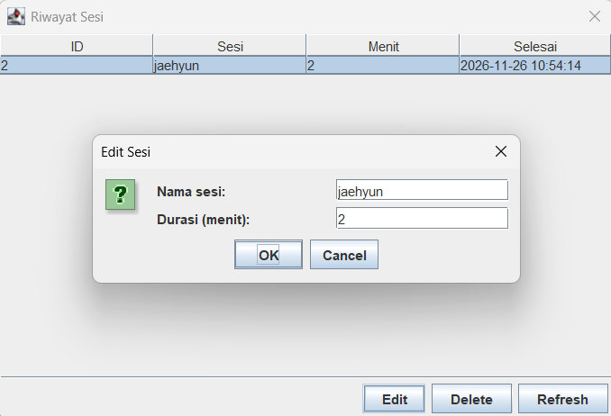

# TaskFlow - Focus Timer

Aplikasi timer fokus berbasis Java Swing. Hitung mundur dijalankan dengan thread, dan riwayat sesi disimpan di database MySQL.

## Fitur

- Mode Focus (25 menit), Short Break (5 menit), dan Long Break (15 menit)
- Start, Pause, dan Reset
- Sesi yang selesai disimpan ke database (`INSERT`) dengan status "Saving…" lalu "Saved ✓"
- Setelah timer habis, klik Start lagi untuk mengulang dari durasi penuh
- Dialog History menampilkan 50 sesi terakhir dalam tabel (`SELECT`)
- **Edit** sesi yang dipilih (`UPDATE`) lewat form kecil; status "Saving…" saat tombol OK diklik
- **Delete** satu atau beberapa baris (`DELETE`); hapus banyak baris memakai **transaction** (`commit` / `rollback`)

### Tampilan Utama


### History


## Struktur Project

```
thread-task/
├── README.md
├── lib/
│   └── mysql-connector-j-x.x.x.jar
├── screenshot/
└── src/
    ├── Main.java                 <- titik masuk program
    ├── db/                       <- semua urusan database
    │   ├── DBUtil.java           koneksi ke MySQL
    │   ├── Session.java          data satu baris riwayat
    │   └── SessionDAO.java       CRUD: insert, getRecent, update, delete, deleteMany
    └── ui/                       <- semua urusan tampilan
        ├── Theme.java            warna dan font
        ├── HeaderPanel.java      judul aplikasi
        ├── TimerPanel.java       tampilan timer dan tombol
        ├── TimerController.java  logika hitung mundur + simpan sesi
        └── HistoryDialog.java    tabel riwayat (edit dan delete)
```

Aturan sederhananya: kode SQL hanya ada di `db/`, kode tampilan hanya ada di `ui/`. `ui/` memanggil `db/SessionDAO`, tidak pernah sebaliknya.

## Kebutuhan

- JDK
- MySQL (XAMPP)
- MySQL Connector/J

## Setup Database

Nyalakan MySQL, lalu jalankan di phpMyAdmin:

```sql
CREATE DATABASE timer_db;
USE timer_db;

CREATE TABLE sessions (
    id INT AUTO_INCREMENT PRIMARY KEY,
    session_name VARCHAR(50),
    minutes INT,
    finished_at TIMESTAMP DEFAULT CURRENT_TIMESTAMP
);
```

Pengaturan koneksi ada di `src/db/DBUtil.java` (user `root`, password kosong).

## Cara Menjalankan

Di VS Code, pastikan file `.jar` ada di **Referenced Libraries**, lalu Run `src/Main.java`.

Lewat CMD (Windows), dari folder `thread-task`:

```
javac -encoding UTF-8 -cp "lib/*" -d bin src/Main.java src/db/*.java src/ui/*.java
java -cp "bin;lib/*" Main
```

(Di Mac/Linux, ganti `;` menjadi `:` pada perintah `java`.)

## Cara Kerja Thread

**Timer.** Saat Start diklik, `thread.start()` menjalankan thread yang menunggu 1 detik berulang kali. Setiap detik, tampilan diperbarui lewat `SwingUtilities.invokeLater`. Pause menghentikan thread dengan `interrupt()`.

**Database.** Semua akses DB memakai pola yang sama:

```
klik / sesi selesai
  -> (EDT) disable tombol + label "Saving…" / "Loading…"
  -> (thread baru) panggil SessionDAO
  -> SwingUtilities.invokeLater
  -> (EDT) enable tombol + update label / tabel
```

Dengan begitu query tidak memblokir GUI. Pola ini ditulis langsung di tiga tempat:

| Lokasi | Untuk |
|---|---|
| `TimerController.saveSession()` | simpan sesi yang selesai (insert) |
| `HistoryDialog.loadData()` | muat tabel riwayat (select) |
| `HistoryDialog.runInThread()` | edit dan hapus (update, delete) |

## SessionDAO

| Operasi | Method | Catatan |
|---|---|---|
| Create | `insert` | `PreparedStatement` |
| Read | `getRecent` | `PreparedStatement` + `ResultSet` |
| Update | `update` | `PreparedStatement` |
| Delete | `delete`, `deleteMany` | `deleteMany` memakai transaction (`setAutoCommit(false)`, `commit`, `rollback`) |
