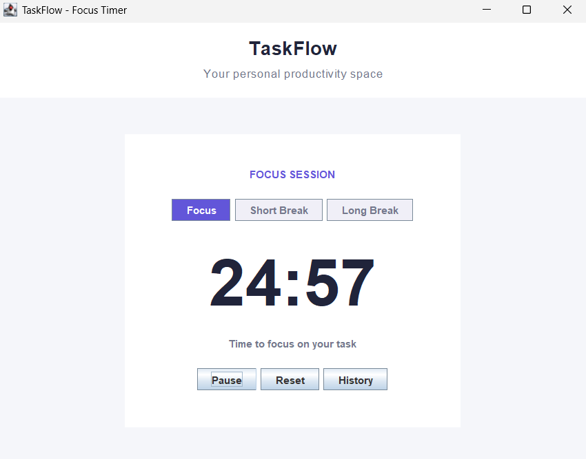

# TaskFlow - Focus Timer

Aplikasi timer fokus berbasis Java Swing. Hitung mundur dijalankan dengan thread, dan riwayat sesi disimpan di database MySQL.

## Fitur

- Mode Focus (25 menit), Short Break (5 menit), dan Long Break (15 menit)
- Start, Pause, dan Reset
- Sesi yang selesai disimpan ke database (`INSERT`)
- History menampilkan 10 sesi terakhir (`SELECT`)

### Tampilan Utama


### History


## Struktur Project

```
thread-task/
├── db/
│   ├── DBUtil.java
│   └── SessionDAO.java
├── lib/
│   └── mysql-connector-j-x.x.x.jar
├── HeaderPanel.java
├── Main.java
├── Theme.java
├── TimerController.java
└── TimerPanel.java
```

## Kebutuhan

- JDK
- MySQL (XAMPP)
- MySQL Connector/J

## Setup Database

Nyalakan MySQL, lalu jalankan di phpMyAdmin:

```sql
CREATE DATABASE timer_db;
USE timer_db;

CREATE TABLE sessions (
    id INT AUTO_INCREMENT PRIMARY KEY,
    session_name VARCHAR(50),
    minutes INT,
    finished_at TIMESTAMP DEFAULT CURRENT_TIMESTAMP
);
```

Pengaturan koneksi ada di `db/DBUtil.java` (user `root`, password kosong).

## Cara Menjalankan

Di VS Code, pastikan file `.jar` ada di **Referenced Libraries**, lalu Run `Main.java`.

Lewat CMD (Windows):

```
javac *.java db/*.java
java -cp ".;lib/*" Main
```

## Cara Kerja Thread

Saat Start diklik, `thread.start()` menjalankan thread yang menunggu 1 detik berulang kali. Setiap detik, tampilan diperbarui lewat `SwingUtilities.invokeLater`. Pause menghentikan thread dengan `interrupt()`.
