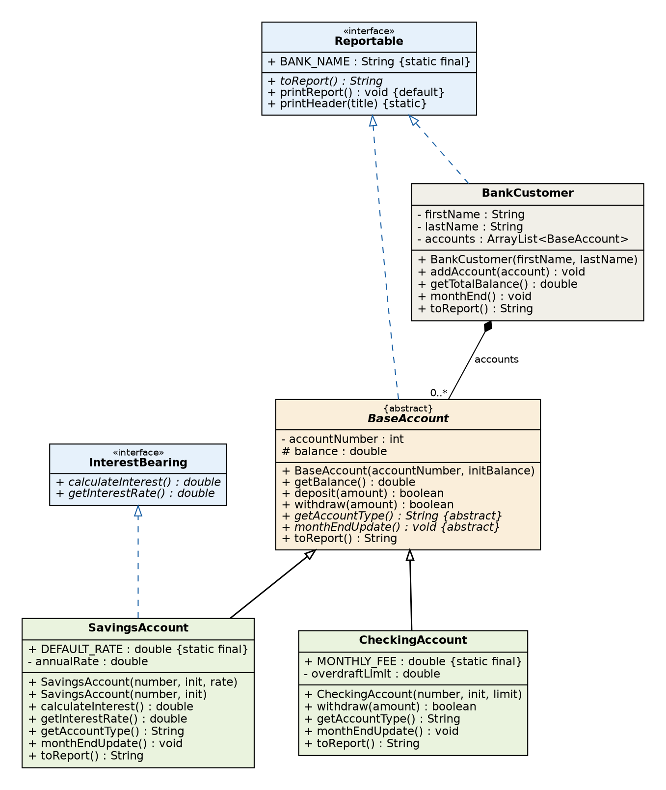

# Mini Bank: Abstract Class, Interface, Inheritance & Polymorphism

Case study for **PBO (Object-Oriented Programming with Java), review before the midtest**.
It uses only topics from the slides *PBO 5 & 6* (Abstraction, Encapsulation, Inheritance, Polymorphism)
and *PBO 7 & 8* (Abstract Class and Interface).

> **Name / NIM / Class:** `<Name>`, `<NIM>`, 5A  *(fill in before submitting)*
> Full write-up: [`CASE-STUDY.md`](CASE-STUDY.md)

| Required topic | Where in this project |
|---|---|
| Abstract class | `BaseAccount` |
| Abstract method | `BaseAccount.getAccountType()`, `BaseAccount.monthEndUpdate()` |
| Interface | `Reportable`, `InterestBearing` |
| Inheritance | `SavingsAccount`, `CheckingAccount` extend `BaseAccount` |
| Polymorphism | overriding (`withdraw`, `monthEndUpdate`, `toReport`) + overloading (`SavingsAccount` constructors) |

## Class diagram



**solid line + hollow triangle** = `extends` (is-a), **dashed line + hollow triangle** = `implements` (can-do),
**filled diamond** = composition (has-a), *italic* = abstract.

## Project structure

```
src/
  Reportable.java        interface: constant, abstract, default and static method
  InterestBearing.java   interface: "can earn interest"
  BaseAccount.java       ABSTRACT class
  SavingsAccount.java    extends BaseAccount, implements InterestBearing
  CheckingAccount.java   extends BaseAccount, overrides withdraw()
  BankCustomer.java      has-a accounts (ArrayList), implements Reportable
  MiniBankDemo.java      main(), prints every result next to its expected value
docs/
  class-diagram.png / .dot   diagram and its Graphviz source
  sample-output.txt          output of MiniBankDemo
```

## Build and run

Works with **JDK 8 or newer**.

```bash
javac -d out src/*.java
java -cp out MiniBankDemo
```

Every line of the output ends with `OK` or `WRONG` (see `docs/sample-output.txt`).
